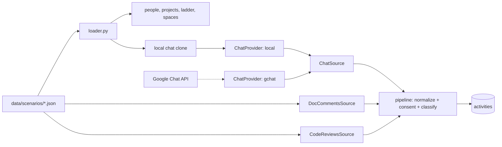

# Unsung Hero

> Surfaces invisible glue work (mentoring, unblocking, code reviews, onboarding, incident firefighting) and ensures engineers receive evidence-backed credit in reviews and promotions.

Architecture principle: **Gemini interprets, code calculates**. Gemini classifies activities and drafts evidence-grounded text; deterministic Python algorithms compute all radar metrics, betweenness centrality, and load distributions. Every claim strictly links to verified evidence.

---

## Quick Start: Running the Application

### Prerequisites
- **Python 3.11+** (virtual environment located in `backend/.venv`)
- **Node.js 18+ & npm** (e.g. from NVM: `export PATH="$HOME/.nvm/versions/node/v24.16.0/bin:$PATH"`)

---

### Step 1: Start the Backend (FastAPI)

In your first terminal:

```bash
cd backend

# Activate Python virtual environment
source .venv/bin/activate

# Build/refresh the SQLite DB from data/scenarios/payments-demo (re-run after editing the JSON)
python -m scripts.seed_db

# Start the API server on port 8000
uvicorn app.main:app --reload --port 8000
```

> **API Health Check**: Open [http://localhost:8000/docs](http://localhost:8000/docs) to view Swagger API documentation.

---

### Step 2: Start the Frontend (Angular)

In your second terminal:

```bash
cd frontend

# If node/npm isn't in your default PATH, load NVM
export PATH="$HOME/.nvm/versions/node/v24.16.0/bin:$PATH"

# Install dependencies (if not already installed)
npm install

# Start the Angular development server on port 4200 (with proxy to port 8000)
npm start
```

> **Open the App**: Visit [http://localhost:4200](http://localhost:4200) in your browser.

*Note: The frontend is also pre-built into `frontend/dist/frontend/browser`. When you start FastAPI without `npm start`, visiting [http://localhost:8000](http://localhost:8000) serves the client directly.*

---

## Demo Personas & Key Workflows

Switch personas using the avatar dropdown in the top-right header or visit `/login`:

| Persona | Role | Key Pages to Test |
| :--- | :--- | :--- |
| **Priya Sharma** (`priya`) | **Unsung Hero (L4 SWE)** | • `/me`: Contribution radar (6 dimensions, 56 evidence items)<br>• `/me/brag`: Month-by-month brag doc with technical-to-business impact translator<br>• `/me/promo`: L5 promotion packet with gap analysis & cited evidence<br>• `/me/privacy`: Audit & control visibility (hide, annotate, dispute evidence) |
| **Karan Patel** (`karan`) | **Engineering Manager** | • `/manager/team`: Team contribution graph & recognition gaps<br>• `/manager/alerts`: Early warning signals (bus factor, ghost credit, load imbalance)<br>• `/manager/review`: Performance review drafter citing verified activities<br>• `/manager/one-on-one`: 1:1 meeting prep with wins, blockers, and unacknowledged help |
| **Arjun Mehta** (`arjun`) | **Peer SWE** | • `/me/thanks`: Suggested prompt to thank Priya for unblocking him on payment retries<br>• `/chat`: Google Chat clone where sending a message automatically syncs into Unsung evidence |

---

## Key Modules & Centralized Constants

All categories, dimensions, roles, and alert types are centralized to eliminate magic strings:
- **Backend Constants**: `backend/app/core/constants.py` (`Category`, `Dimension`, `Role`, `AlertType`, `RecognitionType`, `Defaults`)
- **Frontend Constants**: `frontend/src/app/core/constants.ts` (`ALL_CATEGORIES`, `GLUE_CATEGORIES`, `DIMENSIONS`, `DEFAULT_HERO_ID`, etc.)

```
unsung-hero/
├── data/scenarios/             # All input data as JSON/Markdown (edit here to add stories)
│   └── payments-demo/          # Default demo team
├── backend/
│   ├── app/
│   │   ├── core/constants.py   # Central constants (Categories, Dimensions, Roles, Alerts)
│   │   ├── ingestion/
│   │   │   ├── scenario.py     # Loads + validates a scenario folder
│   │   │   ├── loader.py       # Seeds DB from a scenario, then runs sources
│   │   │   ├── pipeline.py     # Run sources -> classify
│   │   │   ├── sources/        # Activity sources: chat, doc_comments, code_reviews
│   │   │   └── chat_providers/ # Where chat comes from: local clone | gchat
│   │   ├── enrichment/         # Gemini classification & citation enforcement
│   │   ├── metrics/            # Pure Python graph & radar algorithms (no AI)
│   │   ├── generation/         # Evidence-cited review, promo, and thank-you drafts
│   │   ├── api/                # REST endpoints for team, profile, evidence, and chat
│   │   └── services/           # Business logic & database operations
│   └── scripts/seed_db.py      # Seeds the DB from data/scenarios/<name>
├── frontend/                   # Angular standalone client
│   └── src/app/
│       ├── core/constants.ts   # Central frontend constants & defaults
│       ├── features/           # Manager, employee, profile, chat clone, pipeline screens
│       └── shared/             # Radar chart, bubble chart, evidence rows, citation chips
└── docs/                       # Architecture & Google Chat API setup guides
```

---

## Data & Ingestion

All input data is in [`data/scenarios/`](data/scenarios/README.md) as JSON, so you can add a scenario
without changing code:

```bash
# edit/add JSON under data/scenarios/payments-demo/, then:
cd backend && python -m scripts.seed_db                  # rebuild DB from the default scenario
python -m scripts.seed_db --scenario my-team             # use data/scenarios/my-team/
python -m scripts.seed_db --llm                          # classify with Gemini instead of heuristics
```



- **Switching to Google Chat later**: implement `GoogleChatProvider.fetch_new` in
  `backend/app/ingestion/chat_providers/gchat.py` and set `CHAT_PROVIDER=gchat`. Consent, classification and metrics stay the same.
- **New source** (e.g. tickets): add a class with `name` + `pull(db)` in `ingestion/sources/`, register it in
  `sources/__init__.py`, and add it to `ENABLED_SOURCES`.

---

## Configuration (`.env`)

Configuration is loaded from `.env` in the root or `backend/` (see `.env.example`):

```bash
# Gemini API Key (optional — falls back to deterministic heuristic if unset or rate-limited)
GEMINI_API_KEY=your_gemini_api_key_here
GEMINI_MODEL=gemini-3.8-flash

# Database URL (automatically resolves to absolute path backend/unsung.db)
DATABASE_URL=sqlite:///./unsung.db

# Data sources
DATA_SCENARIO=payments-demo                     # folder under data/scenarios/
CHAT_PROVIDER=local                             # local | gchat
ENABLED_SOURCES=chat,doc_comments,code_reviews

API_BASE_URL=http://localhost:8000
```
